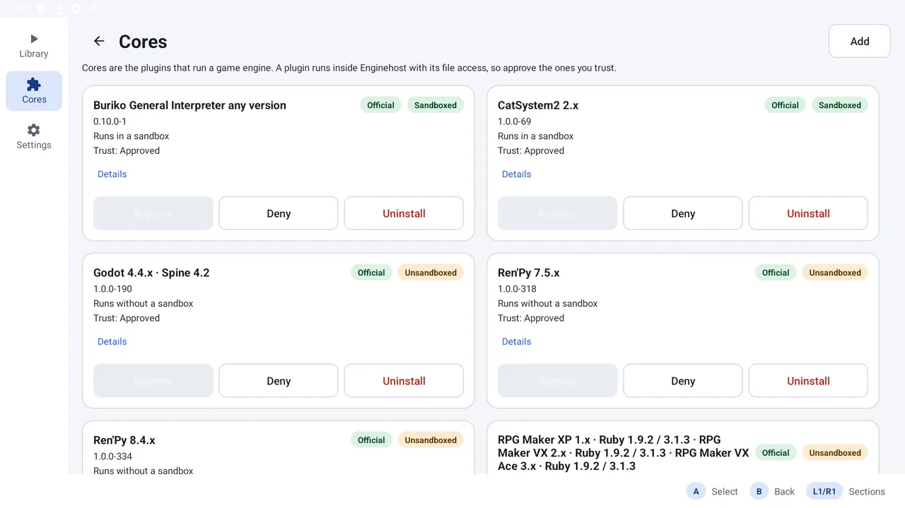

<h1 align="center">Enginehost</h1>

<p align="center">
  <b>A multi-engine game host for Android.</b><br>
  Visual novels and RPG Maker games run from their own folder, each engine in its own signed core.
</p>

<p align="center">
  <a href="https://github.com/Droidtop/enginehost/releases"></a>
  <a href="https://github.com/Droidtop/enginehost/actions/workflows/build.yml"></a>
  
  <a href="LICENSE"></a>
  
</p>

<p align="center">
  
</p>

<p align="center">
  <a href="#what-it-does">What it does</a> ·
  <a href="#install">Install</a> ·
  <a href="#engines">Engines</a> ·
  <a href="#use-it-from-a-launcher">Launcher contract</a> ·
  <a href="#faq">FAQ</a> ·
  <a href="#licence">Licence</a>
</p>

Enginehost is to visual-novel and PC-game engines what RetroArch is to emulators: one frontend, and each engine a separately installed core. It runs games made with engines such as Ren'Py, RPG Maker, KiriKiri and Godot on Android, without converting or repacking them. You point it at the game's folder and it reads the game where it is. It works on its own as a complete app, and it can be driven by a launcher such as [droidtop](https://github.com/Droidtop/droidtop) over a small Intent contract.

## What it does

| | |
|---|---|
| **A library** | Every game you add or scan, filterable by engine, platform, status, folder and text, sortable by name, date added, recent play and size. |
| **Config creator** | Reads a game folder, detects the engine and version, and writes the folder's `enginehost.json` only when you press Save. |
| **Engines as cores** | Each engine is a separately installed, versioned bundle. Several versions of one engine can sit side by side. |
| **Trust first** | A core must be signed and approved by you before it runs. Each card shows whether it runs in a sandbox. |
| **Pad and touch** | Every screen works from a controller. Global remapping, multiple controllers, hot-plug and rumble are supported. |
| **Drivable** | Every screen has an Intent equivalent, so a launcher can do the whole job without a hand-off. |

Games it cannot run are still listed and tagged with the builds they ship, so other runners can pick them up.

## Install

You need a device on Android 8.0 or newer.

1. Open [Releases](https://github.com/Droidtop/enginehost/releases) and download `enginehost-latest.apk` from the **latest build** release.
2. Open the file and allow the install when Android asks.
3. Start Enginehost, open **Cores**, press **Add**, and install the cores for the engines your games use.
4. In **Library**, press **Add games** and pick a game folder, or a folder of games to scan.

`enginehost-latest-debug.apk` is the debuggable build for inspecting with adb. Every build also keeps its own release, so the release list is the build history.

## Engines

Each repository is one core, packaged as a signed engine bundle. Cores need an actual implementation of the engine. Handing a game to Wine or a PC compatibility layer does not count.

| Engine | Core | Notes |
|---|---|---|
| Ren'Py | [enginehost-renpy-plugin](https://github.com/Droidtop/enginehost-renpy-plugin) | One branch per engine minor, 7.3 to 7.8 and 8.0 to 8.5 |
| RPG Maker XP, VX, VX Ace | [mkxp-z](https://github.com/Droidtop/enginehost-rpgmaker-mkxp-z-plugin) | |
| RPG Maker 2000, 2003 | [EasyRPG](https://github.com/Droidtop/enginehost-rpgmaker-easyrpg-plugin) | |
| RPG Maker MV, MZ | [mv-mz](https://github.com/Droidtop/enginehost-rpgmaker-mv-mz-plugin) | Runs over a WebView |
| KiriKiri | [kirikiri](https://github.com/Droidtop/enginehost-kirikiri-plugin) | |
| Buriko / Ethornell | [buriko](https://github.com/Droidtop/enginehost-buriko-plugin) | Built on OpenBGI |
| CatSystem2 | [catsystem2](https://github.com/Droidtop/enginehost-catsystem2-plugin) | Own scene player, no menus or saves yet |
| CMVS | [cmvs](https://github.com/Droidtop/enginehost-cmvs-plugin) | Experimental: no opcodes, choices, graphics, audio or saves yet |
| Flash and AIR | [flash-air](https://github.com/Droidtop/enginehost-flash-air-plugin) | Built on Ruffle |
| HTML and Twine | [html](https://github.com/Droidtop/enginehost-html-plugin) | Web games and compiled Twine stories |
| NScripter | [nscripter](https://github.com/Droidtop/enginehost-nscripter-plugin) | Built on OnscripterYuri |
| Godot | [godot](https://github.com/Droidtop/enginehost-godot-plugin) | One branch per engine minor, 4.0 to 4.7 |

Compatibility is never guessed from nearby version numbers. A core supports only the versions, ranges and series it declares.

## Use it from a launcher

One Intent starts a game:

```
action: dev.enginehost.LAUNCH
extra "path":   absolute path to the game's folder
extra "config": optional enginehost.json-shaped JSON
```

The same folder can hold an `enginehost.json` that names the engine and version. Without one, detection reads the folder. Enginehost never copies or moves the game. `dev.enginehost.CONFIGURE` opens the config creator, and `content://dev.enginehost.capabilities/installed` lists what is installed.

The full contract, the config file, the core format and the catalog design are in [docs/contract.md](docs/contract.md).

## FAQ

**Is Enginehost only for droidtop?**
No. It is a complete app. droidtop treats it as one more emulator.

**Does it run Windows builds of games?**
No. It runs games through cores. Windows and Linux builds that it finds are listed but not launched.

**Where do saves go?**
Where the engine would normally put them. Engines that save beside the game keep doing that. The in-game menu's Save location shows the real folder.

**Is a core a separate app?**
No. A core is a signed bundle that Enginehost verifies, stores privately and loads in its own runtime process.

**Is it finished?**
No. See the engine table for what each core covers today.

## Licence

Enginehost is licensed under the **GNU General Public License v3.0**, see [LICENSE](LICENSE). The launch screen sets titles in Gantari (SIL Open Font License 1.1, see `third_party/gantari/OFL.txt`). Cores keep the licences of the upstream engines they build on, and each lives in its own repository.
